<h1 align="center">PhoneCam</h1>

  <b>Visage et voix transformés en direct, et un Studio pour retoucher après coup.</b> 
  Webcam du PC ou téléphone Android → caméra virtuelle et micro virtuel, pour la visio, le stream et les appels.

  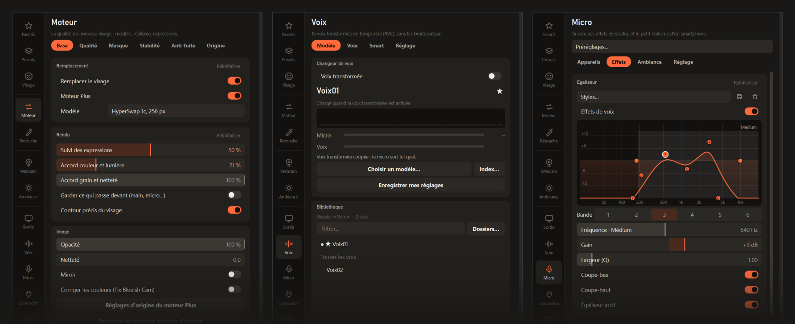

  <a href="#installer">Installer</a> ·
  <a href="#petit-tuto">Petit tuto</a> ·
  <a href="#la-voix">La voix</a> ·
  <a href="#le-studio">Le Studio</a> ·
  <a href="#presets">Presets</a> ·
  <a href="#ce-quil-faut">Ce qu'il faut</a> ·
  <a href="#contenu-du-dossier">Contenu</a>

---

## En bref

| | |
| --- | --- |
| 🎥 **Direct** | Remplace le visage en temps réel (moteur **Plus** basé sur FaceFusion : HyperSwap, HRFFA, LivePortrait, XSeg) et l'envoie sur **« OBS Virtual Camera »**, visible par Discord, Snapchat, OBS, Teams… |
| 🎙️ **Voix** | Ta voix transformée en temps réel par un modèle **RVC**, avec **Smart** (seule ta voix entre dans le modèle : clavier, souffle, ventilateur restent dehors). **Deux voix fournies.** |
| 🎚️ **Micro** | Égaliseur, compresseur, de-esser, chaleur, pièce et réalisme d'un micro de smartphone. |
| 🎬 **Studio** | Les mêmes outils sur des vidéos, des images et des sons : retouches, effets webcam, couleur, voix, puis export. |
| 🛡️ **Anti-fuite** | Quand la détection décroche, l'image reste figée : le vrai visage n'est jamais montré. |

---

## Installer

> Il faut Windows 10 / 11, une carte graphique **NVIDIA** (RTX conseillée) et environ 20 Go libres.

1. En haut de cette page : **Code → Download ZIP**, puis **extraire** le zip (par exemple dans Documents).
2. Double-clic sur **`Installer.bat`**.
   Si Windows affiche « Windows a protégé votre ordinateur » : **Informations complémentaires → Exécuter quand même**.
   Compter 20 à 40 minutes (environ 8,5 Go téléchargés : Python, paquets, modèles du visage et de la voix, OBS, ffmpeg, adb).
   En cas d'erreur, relancer `Installer.bat` reprend où il s'est arrêté.
3. Si OBS vient d'être installé : **redémarrer le PC** une fois.

Ensuite, à chaque fois : double-clic sur **`Lancer PhoneCam.bat`**.

---

## Petit tuto

Au premier lancement, un accueil explique les deux espaces. Le bouton **?** en haut à droite le rouvre,
et chaque icône de la colonne de gauche affiche une bulle d'aide au survol.

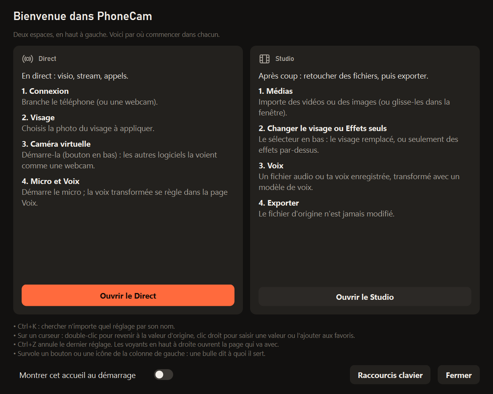

### 1. Passer en direct (espace « Direct »)

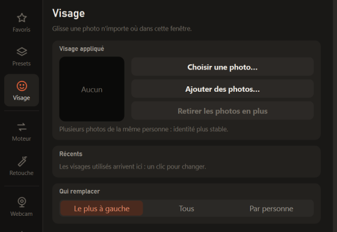

La liste **« Prêt pour l'antenne ? »**, au milieu de la fenêtre, dit ce qui manque. Clique sur une étape pour y aller :

1. **Connexion** : choisis la source vidéo, **Webcam du PC** ou **Téléphone** (appli Android, en Wi-Fi par QR code ou par câble).
2. **Visage** : « Choisir une photo… » (3 à 10 photos de la même personne donnent un visage plus stable).
3. **Caméra virtuelle** : bouton en bas (F5). Dans Discord, Snapchat, OBS… choisis la caméra **« OBS Virtual Camera »**.
4. **Micro** : bouton en bas (F6), puis la voix si tu veux (voir ci-dessous).

> 💡 Le premier lancement du moteur Plus prépare des moteurs TensorRT pour ta carte graphique : quelques minutes, une seule fois.

 

### 2. Régler le rendu

Dans la colonne de gauche : **Moteur** (qualité du visage), **Retouche** (forme, peau, maquillage),
**Webcam** (les défauts d'une vraie webcam), **Ambiance** (lumière de la pièce), **Sortie** (taille et cadrage).

<table>
  <tr>
    <td>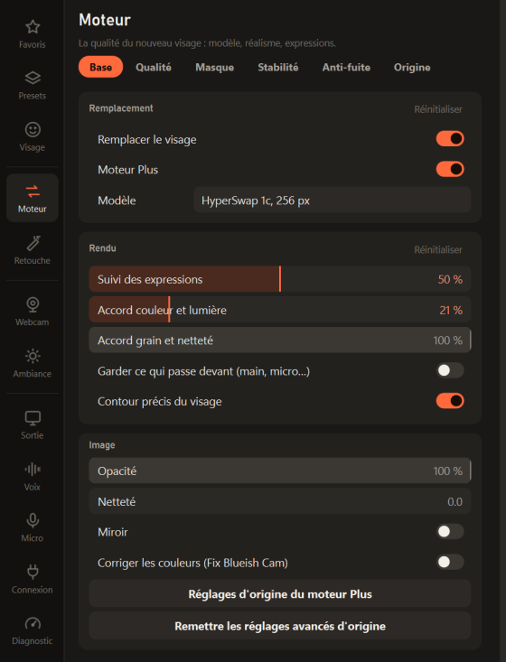</td>
    <td>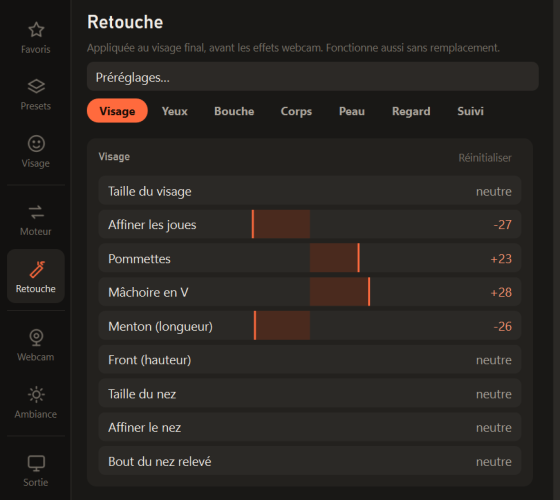 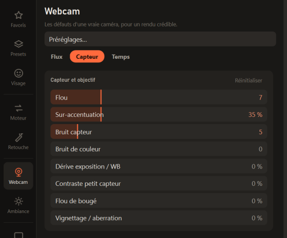</td>
  </tr>
  <tr>
    <td align="center"><b>Moteur</b> : modèle, expressions, couleur, contour</td>
    <td align="center"><b>Retouche</b> et <b>Webcam</b></td>
  </tr>
</table>

- **Ctrl+K** cherche n'importe quel réglage par son nom.
- Sur un curseur : **double-clic** pour revenir à la valeur d'origine, **clic droit** pour saisir une valeur ou l'ajouter aux favoris.
- **Ctrl+Z** annule le dernier réglage.
- Le bord droit du panneau se tire à la souris pour l'élargir.

---

## La voix

<table>
  <tr>
    <td>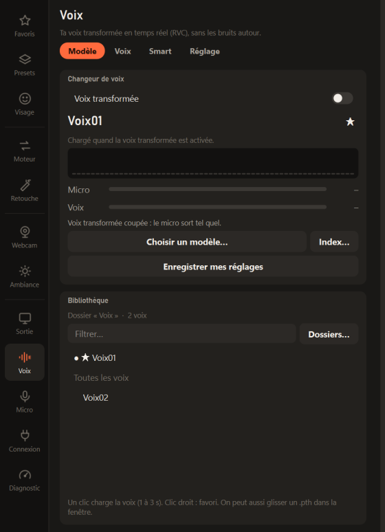</td>
    <td>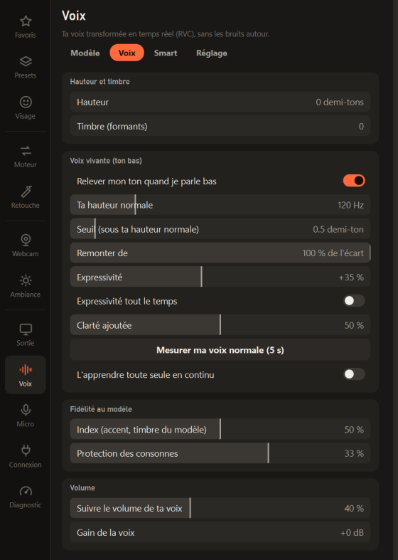</td>
  </tr>
  <tr>
    <td align="center"><b>Modèle</b> : la voix et la bibliothèque (deux voix fournies)</td>
    <td align="center"><b>Voix</b> : hauteur, timbre, voix vivante</td>
  </tr>
</table>

1. Page **Micro → Appareils** : choisis ton micro en **Entrée**, et une **Sortie** (avec [VB-Cable A+B](https://vb-audio.com/Cable/), les autres logiciels prennent **« CABLE-B Output »** comme micro).
2. Page **Voix** : choisis une voix dans la **Bibliothèque** (Voix01 et Voix02 sont fournies), puis active **« Voix transformée »** (F2).
3. Onglet **Voix** : hauteur (+12 = une octave au-dessus), timbre, ressemblance au modèle.

Ta voix d'origine ne sort **jamais** quand le changeur est actif : en attendant le modèle, c'est le silence.
Pour ajouter tes propres voix : range-les dans le dossier **`Voix`** (un sous-dossier par voix, avec son `.pth` et son `.index`),
ou **« Dossiers… »** pour ajouter un autre dossier.

### Effets du micro

<table>
  <tr>
    <td>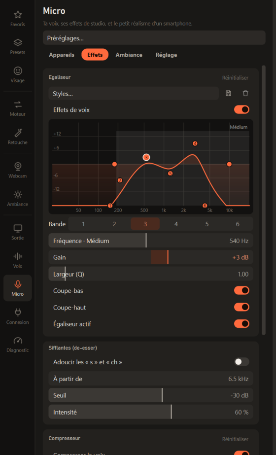</td>
    <td>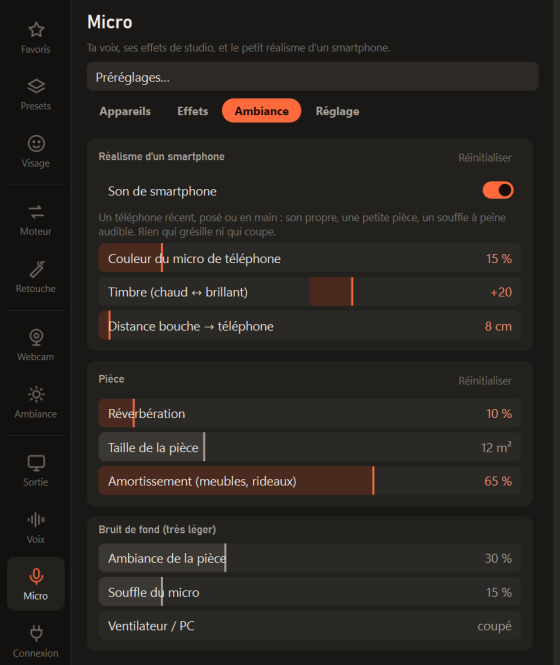</td>
  </tr>
  <tr>
    <td align="center"><b>Effets</b> : égaliseur, sifflantes, compresseur</td>
    <td align="center"><b>Ambiance</b> : smartphone, pièce, bruit de fond</td>
  </tr>
</table>

Page **Micro → Effets** : un égaliseur visuel (glisse les points, molette pour la largeur), sifflantes, compresseur, chaleur.
Onglet **Ambiance** : son de smartphone, pièce, bruit de fond très léger.

---

## Le Studio

Le Studio travaille sur des fichiers, sans rien envoyer en direct. Le fichier d'origine n'est jamais modifié.

**Vidéos et images**

1. **Médias** : glisse des vidéos ou des images dans la fenêtre.
2. En bas : **« Changer le visage »** ou **« Effets seuls »** (le visage d'origine est gardé, seulement les effets par-dessus).
3. Règle **Webcam**, **Ambiance**, **Couleur**… L'aperçu **Avant / après** compare d'un coup d'œil.
4. **Exporter** (MP4, ProRes, PNG, JPEG ; le son est gardé).

**Sons : page Voix du Studio**

<table>
  <tr>
    <td>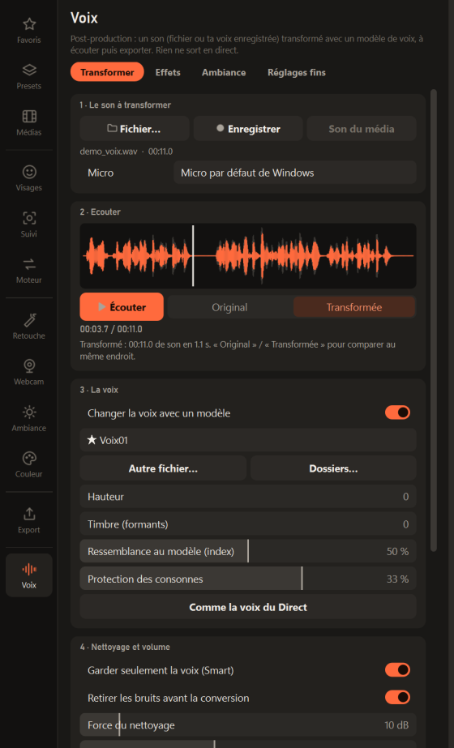</td>
    <td>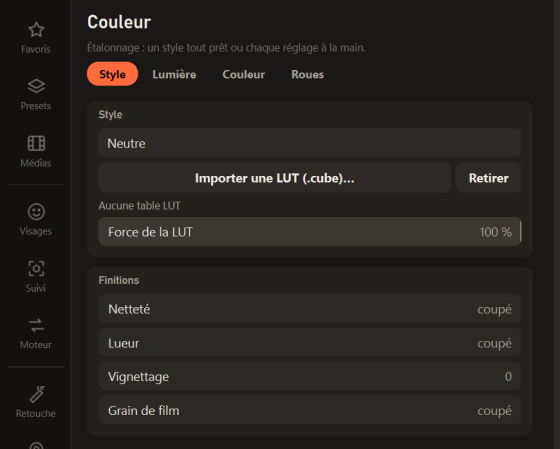</td>
  </tr>
  <tr>
    <td align="center"><b>Voix du Studio</b> : un son transformé, écouté en A/B</td>
    <td align="center"><b>Couleur</b> : style, LUT, lumière, roues</td>
  </tr>
</table>

1. **Le son** : un fichier audio, **« Enregistrer »** (ton micro) ou **« Son du média »** (le son de la vidéo choisie).
2. **La voix** : choisis-la et règle-la. Le son est transformé tout seul.
3. **Écouter** : « Original » / « Transformée » passent de l'un à l'autre au même endroit (touche **A**).
4. **Exporter** : WAV, FLAC, MP3, M4A, ou **la vidéo avec la nouvelle voix** (image copiée sans perte).

Les onglets **Effets** et **Ambiance** reprennent tous les effets de la page Micro.
« Changer la voix avec un modèle » coupé : seulement les effets, la voix d'origine est gardée.

---

## Presets

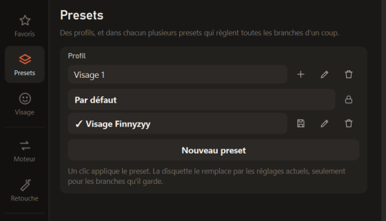

Un preset règle tout d'un coup (visage, moteur, retouches, webcam, ambiance, sortie, micro, voix).
Ils sont communs au Direct et au Studio. L'icône en haut de la fenêtre change de preset d'un clic.

- **Par défaut** : le moteur Plus réglé, tout le reste neutre. Toujours là, appliqué au premier lancement.
- **Visage Finnyzyy** : moteur, retouches, effet webcam, ambiance et micro (égaliseur, compresseur, pièce, son de smartphone).
- **Nouveau preset** garde tes réglages actuels ; la disquette met un preset à jour.

La photo du visage n'est dans aucun preset fourni : choisis-la dans la page Visage, puis enregistre-la dans ton preset.

 

---

## Téléphone (facultatif)

Android 9 ou plus récent. Installe **`Appli Android\PhoneCam.apk`** sur le téléphone :

- copie-le sur le téléphone et ouvre-le, en autorisant l'installation d'applis inconnues ;
- ou, avec le câble et le débogage USB activé :
  `Programme\tools\platform-tools\adb.exe install "Appli Android\PhoneCam.apk"`.

Puis, dans PhoneCam : **Connexion → Connecter par câble**, ou scanne le QR code en Wi-Fi.

---

## Ce qu'il faut

- Windows 10 ou 11 (64 bits)
- Une carte graphique NVIDIA récente (RTX conseillée), pilote à jour
- Environ 20 Go libres, et Internet pour l'installation
- Facultatif : un téléphone Android, [VB-Cable A+B](https://vb-audio.com/Cable/) pour le micro virtuel

---

## Contenu du dossier

| | |
| --- | --- |
| `Lancer PhoneCam.bat` | **le logiciel** |
| `Installer.bat` | l'installation (une fois) |
| `LISEZMOI.txt` | le mode d'emploi complet, réglage par réglage |
| `Voix\` | les voix du changeur de voix (deux fournies) |
| `Presets\` | les presets fournis |
| `Captures\` | créé à l'installation : photos, enregistrements, captures de diagnostic |
| `Appli Android\` | l'appli du téléphone, déjà compilée |
| `Programme\` | le moteur : rien à y toucher |

Dans <code>Programme\</code> (pour le développement)

- `PhoneCam\` : le code Python de PhoneCam, sa page web, et `android\` (code de l'appli : Android Studio, ou JDK 17 + SDK : `gradle assembleDebug`).
- `app\` : [Deep-Live-Cam](https://github.com/hacksider/Deep-Live-Cam) (détection des visages, inswapper, GFPGAN / GPEN).
  `Lancer Deep-Live-Cam.bat` ouvre son interface d'origine (facultatif).
- `wheels\` : insightface déjà compilé (évite d'installer Visual Studio). `requirements.txt` : versions exactes des paquets Python.
- Créés par l'installateur, jamais envoyés en ligne : `venv\` (Python), `data\` (modèles, réglages, caches), `tools\` (adb).

Désinstaller : supprimer le dossier. Python, OBS et ffmpeg se désinstallent depuis les Paramètres de Windows.

---

## Licences

Deep-Live-Cam est sous licence AGPL-3.0 (`Programme\app\LICENSE`). Les modèles du visage viennent de
[FaceFusion](https://github.com/facefusion/facefusion-assets) et de Deep-Live-Cam, chacun sous sa propre licence ;
plusieurs (HyperSwap, inswapper…) sont réservés à un usage non commercial.
Voix : RVC (Retrieval-based-Voice-Conversion-WebUI, MIT), RMVPE et HuBERT / ContentVec
(huggingface.co/lj1995/VoiceConversionWebUI), Silero VAD (MIT), GTCRN (MIT).

**Ne s'en servir qu'avec l'accord des personnes dont on utilise le visage ou la voix.**
